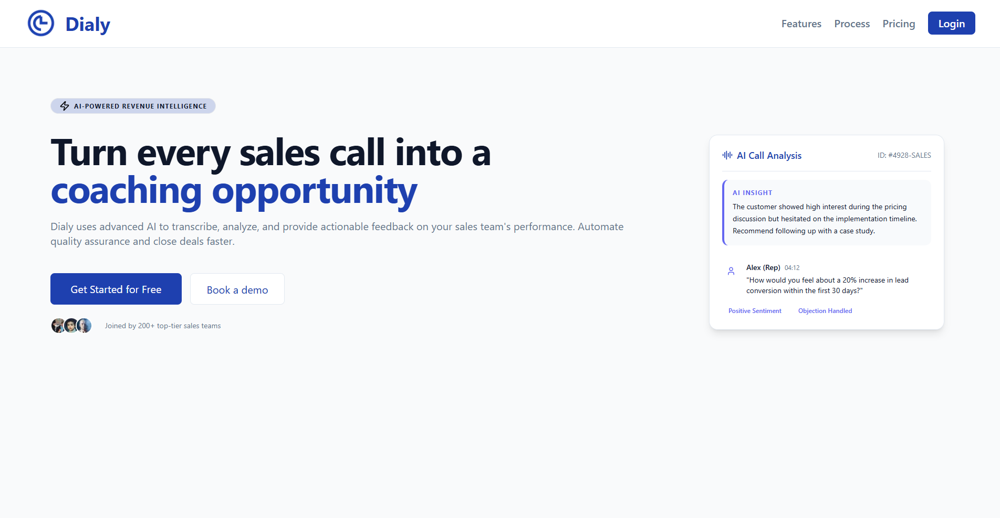

# Dialy: AI call QA and lead scoring for sales teams

**Live:** [dialy.site](https://dialy.site)



> Dialy is a commercial product, so the source code is private. This repo covers what it does, how it's built and the engineering decisions behind it. I'm happy to walk through the code in an interview.

## The problem

Real-estate cold callers make hundreds of calls a week and almost nobody reviews them. Reps don't know why they lose leads, and managers can't listen to everything.

## What Dialy does

1. A rep uploads a call recording.
2. The audio is transcribed.
3. An AI pipeline analyses the conversation and scores the rep (opener, objection handling, closing) and the lead (motivation, timeline, qualification).
4. The rep gets a report with what went wrong and how to fix it on the next call.

## Features

- Call upload, transcription and AI analysis that runs on a background job queue
- Rep performance scoring and lead scoring with a per-call report
- Credit-based billing with credit packs and order tracking
- Email OTP sign-up and login, plus trial-abuse protection (email and device fingerprint checks)
- Admin panel with TOTP 2FA, backup codes and server-side sessions
- Affiliate program with click attribution
- First-party marketing analytics (links, clicks, page views)
- Support inbox

## Architecture

```
Next.js client (Vercel)
        │  REST + JWT (httpOnly cookies)
        ▼
Express API (Fly.io) ──► PostgreSQL (Prisma, row-level security)
        │                     ▲
        ▼                     │
  pg-boss job queue ──► Worker: transcription → AI analysis → scoring → report
```

- **Client:** Next.js 16 (App Router), React, TypeScript, Tailwind, TanStack Query (with persisted cache), Zustand, Recharts
- **API:** Express + TypeScript, modular structure (auth, calls, orders, user, admin, affiliate, marketing, support)
- **Data:** PostgreSQL with Prisma (21 models), plus a row-level-security lockdown layer
- **Jobs:** pg-boss queue with a separate worker process for call analysis, and cron jobs for token and data cleanup
- **AI:** AssemblyAI for transcription, LLMs (OpenAI / Cohere) for analysis and scoring
- **Infra:** Vercel (client), Fly.io + Docker (API and worker), Cloudinary (media), Resend (email), Winston logging
- **Security:** bcrypt, JWT, rate limiting, OTP attempt limits, TOTP 2FA for admins
- **Workflow:** `dev → staging → main` branches, a separate test database, 130+ commits

## Engineering notes

I keep a devlog of bugs worth learning from. A few of them:

- **Charging for work that never happened.** Checking the balance, deducting credits and creating the call were three separate transactions. A failure in between could charge the user for nothing, and two uploads at once could both pass the check and push the balance negative. Fix: one transaction with an atomic deduction. Lesson: anything that moves money and creates work is a single unit.
- **Testing RLS as a superuser proves nothing.** Row-level-security tests passed because the test role bypasses RLS. Fix: run them as the real app role.
- **Brute-forcing a six-digit code.** OTP attempts were rate-limited per IP, not per account. Fix: limit attempts per account and invalidate the code after too many failures.
- **The model does the arithmetic and we write it down.** The LLM's JSON went straight into Postgres, including a total score it added up itself. Fix: validate the output, drop unknown keys, clamp each part to its range and recompute the total on the server.
- **A blank panel is not a loading state.** Slow analyses looked like broken pages. Fix: explicit queued, processing and failed states in the UI.

## Built by

[Saif Tamer](https://github.com/SaifTamer2010) · [LinkedIn](https://www.linkedin.com/in/saif-tamer-6477a7349/)
